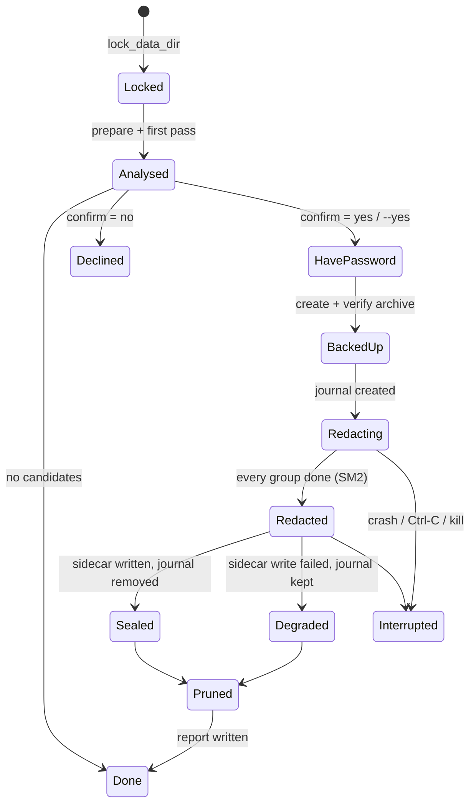
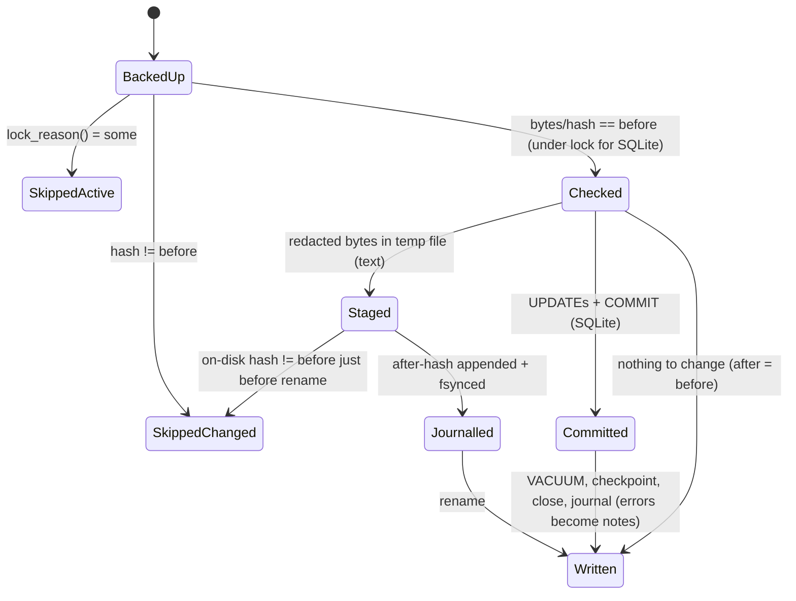

# State machines

This page maps every state machine in Neuroalyzer, explicit or implicit. For each one it gives the states, the transitions and the invariants the code relies on. It then lists the invalid states and transitions that the code could actually reach, with evidence, and what was done about each.

Audit baseline: commit `5814b2f`. Every finding below is fixed on `main`. Fixed findings link to the issue that holds the full write-up. The [Residual risks](#residual-risks) section lists what is known and still open.

## Contents

- [Overview](#overview)
- [SM1. A clean run](#sm1-a-clean-run)
- [SM2. One candidate group during clean](#sm2-one-candidate-group-during-clean)
- [SM3. Backup files on disk](#sm3-backup-files-on-disk)
- [SM4. One group during restore](#sm4-one-group-during-restore)
- [SM5. A session file across runs](#sm5-a-session-file-across-runs)
- [SM6. The SQLite write transaction](#sm6-the-sqlite-write-transaction)
- [SM7. Password resolution](#sm7-password-resolution)
- [SM8. The HMAC key](#sm8-the-hmac-key)
- [SM9. The NER model files](#sm9-the-ner-model-files)
- [SM10. The run lock](#sm10-the-run-lock)
- [Findings](#findings)
- [Issues and fixes](#issues-and-fixes)
- [Residual risks](#residual-risks)
- [Keeping this page current](#keeping-this-page-current)

## Overview

None of these machines is an `enum` with a `match`. Each is implicit in one of three places:

- the order of statements in `run::clean` and `run::restore`
- the files present in the data directory
- how a session file's hash compares with the `before` and `after` hashes in a backup

That makes them easy to break by reordering code, so each section below states the invariant that a change has to keep.

| Machine | Where it lives | Kind |
|---|---|---|
| SM1 clean run | `run::clean` | Control flow |
| SM2 candidate group | `run::redact_group` | Control flow and file hashes |
| SM3 backup files | `backup::{reserve, create, Journal, write_after, prune}` | Files in `archives/` |
| SM4 restore group | `backup::restore` | Hash comparisons |
| SM5 session file | Spans clean and restore | Hash of the file vs `before` and `after` |
| SM6 SQLite write | `sqlite::process_checked` | SQLite lock state |
| SM7 password | `password::resolve` | Ordered chain |
| SM8 HMAC key | `token::Tokenizer::load_or_create` | A file in the data dir |
| SM9 model files | `ner::fetch`, `fsutil::install_verified` | Files in `models/` |
| SM10 run lock | `paths::lock_data_dir` | OS file lock |

## SM1. A clean run



| From | Event | To | Side effects |
|---|---|---|---|
| start | `lock_data_dir` succeeds | Locked | Holds `neuroalyzer.lock`. Fails at once if another clean or restore holds it. |
| Locked | first pass | Analysed | Read-only. Files active or locked by another process are marked skipped here. |
| Analysed | no file would change | Done | No backup, no journal. |
| Analysed | user declines | Declined | Nothing written. Exit 0. |
| HavePassword | `backup::create` ok | BackedUp | Archive verified and renamed from `.partial`. |
| HavePassword | `create` fails | error exit | `.partial` removed. No session file touched. |
| BackedUp | `Journal::create` | Redacting | `<archive>.after.journal` exists. |
| Redacting | all groups finished | Redacted | Each group is Written or Skipped (SM2). |
| Redacted | `write_after` ok | Sealed | `.after.age` written. Journal deleted. |
| Redacted | `write_after` fails | Degraded | Journal kept. Report still written. Exit 2. |
| Redacting or Redacted | process dies | Interrupted | Archive and journal on disk, no sidecar. Restore uses the journal (SM3). |

Invariants:

- **I1.1** No session file is written before a verified archive exists. `create` returns only after `verify`.
- **I1.2** Once any session file is written, every written file has an after-hash in durable storage: the journal first, then the sidecar. Before the fix, the state "Redacting or Redacted with no after-hashes" was reachable and made restore refuse everything (F2).
- **I1.3** The report never contradicts the disk. A file that was changed is reported `modified: true`, even if a step after the commit failed (F11, F12).
- **I1.4** At most one clean or restore runs per data dir (F7).

## SM2. One candidate group during clean

A group is one file, or one SQLite database with the `-wal` and `-journal` files it had at backup time.



| From | Guard | To | Records |
|---|---|---|---|
| BackedUp | A file in the group is locked or open elsewhere | SkippedActive | No after-hash |
| BackedUp (text) | Hash of the bytes read ≠ `before` | SkippedChanged | No after-hash |
| BackedUp (SQLite) | Inside `BEGIN IMMEDIATE`: a hash ≠ `before`, or a companion that wasn't backed up is non-empty | SkippedChanged | No after-hash, transaction rolled back |
| Staged | On-disk hash ≠ `before` just before the rename | SkippedChanged | Temp file removed, nothing journalled |
| Staged | Unchanged | Journalled, then Written | Journal: the hash of the bytes written |
| Committed | Any later step fails | Written | Drift note, report `modified: true` |

Invariants:

- **I2.1 (what was redacted was backed up)** The bytes that get redacted are exactly the bytes whose hash is `before`. Before the fix, the check hashed the file and the redaction then read it again (F3, F4).
- **I2.2 (no lost update)** A write by another process that lands before the rename is never overwritten (F3). For SQLite, no other writer can commit between the check and our commit (F4).
- **I2.3 (activity is checked close to the write)** The lock check runs again just before writing, not only in the first pass (F8).
- **I2.4 (after-hash describes our own write)** The after-hash is the hash of the bytes Neuroalyzer wrote. It is never read back from the disk later, and a skipped group has none (F10).

## SM3. Backup files on disk

States are named by which files exist for one backup base name `B` under `archives/`.

| State | Files present | Reached by | Meaning |
|---|---|---|---|
| Reserved | `B.tar.zst.age.partial` (empty) | `reserve` (`create_new`) | Name claimed. |
| Writing | `B….partial` | `create` streaming | Not yet verified. |
| Archived | `B.tar.zst.age` | Verify ok, then rename | No session file touched yet. |
| Journalling | archive + `B.after.journal` | `Journal::create` | Redaction in progress. |
| Sealed | archive + `B.after.age` | `write_after`, then journal removed | Normal end state. |
| Recoverable | archive + journal, no sidecar | Crash or `write_after` failure | Restore uses the journal. |
| Pruned | none | `prune` | Only names Neuroalyzer made are pruned. |
| Stale partial | `B….partial` with no live run | Crash during `create` | Removed by the next `prune`, which runs under the run lock. |

| Transition | Guard or ordering |
|---|---|
| none → Reserved | `create_new` on the partial file. On `AlreadyExists`, try the next suffix `-1`, `-2`, … (F5). |
| Writing → none | Any write or verify failure removes the partial file. |
| Archived → Journalling → Sealed | The journal is deleted only after the sidecar has been renamed into place. |
| Sealed or Recoverable → Pruned | Ranked newest first by the parsed `(timestamp, numeric suffix)` key (F1). Names Neuroalyzer didn't make are never counted or deleted. |

Invariants:

- **I3.1** Archive names are unique among concurrent runs (F5).
- **I3.2** `list` and `prune` agree that the archive just written is the newest one (F1).
- **I3.3** A restore argument resolves to exactly one archive: a path, an exact name, or a prefix that matches only one name (F6).
- **I3.4** The journal holds only entry ids and BLAKE3 hashes of redacted content, never values. Mode 0600. A torn last line is ignored.

## SM4. One group during restore

The decision is made once per group, when its first entry (the main file) is read from the archive.

| Condition, checked in this order | Decision | Reported as |
|---|---|---|
| Every file in the group hashes to `before` | Leave all | `unchanged` |
| Any file in the group is locked or open elsewhere | Skip all, **even with `--force`** | `active: …; not overwritten` (F9) |
| Every file matches its after-hash (from the sidecar or the journal) | Restore | `restored` |
| `--force` | Restore | `restored` |
| The sidecar has no after-hash for any file in the group | Skip | `clean didn't change this file …` (F10) |
| Terminal and the user says yes | Restore | `restored` |
| Otherwise | Skip | `changed since cleaning …` |

Each entry is then handled on its own. An entry already at `before` is `unchanged`. An entry whose archived bytes don't hash to `before` is skipped as damaged. Otherwise it is written atomically with its original mode and mtime, and for SQLite the stale `-shm` file and any `-wal` or `-journal` that wasn't backed up are removed.

Invariants:

- **I4.1** Restore never replaces a file another process has locked or open (F9).
- **I4.2** Restore never silently replaces content that clean didn't write (F10).
- **I4.3** A clean that was interrupted can still be restored without `--force` (F2, through the journal).

## SM5. A session file across runs

Let `h` be the file's current hash, and `before` and `after` the values in the newest backup that contains it.

| State | Definition | Next clean | Restore |
|---|---|---|---|
| Original | `h == before` (or never backed up) | Candidate if it has findings | `unchanged` |
| Redacted | `h == after` | Usually no findings, so not a candidate | Restores without asking |
| Edited | `h ∉ {before, after}` | New candidate, new backup | Asks, or skips without a terminal; `--force` overwrites |
| Untouched-but-moved | Clean skipped it, and `h != before` | Candidate | Skips (`clean didn't change …`) unless `--force` |

Before the fix, Untouched-but-moved was folded into Redacted, which was the invalid transition behind F10.

## SM6. The SQLite write transaction

```
open RW ─► secure_delete=ON ─► BEGIN IMMEDIATE ─┬─ busy ───────────► Busy (skip, nothing changed)
                                                └─ precheck ─┬─ fail ► Changed (rollback on drop)
                                                             └─ ok ──► scan rows ─► UPDATEs ─► COMMIT
COMMIT ─► VACUUM ─► wal_checkpoint(TRUNCATE) ─► close ─► journal after-hashes ─► Done
             └── any error after COMMIT ──► drift note, still Done (F11)
```

Invariant **I6.1**: nothing is read for redaction before the `RESERVED` lock is held, and the precheck runs while holding it. Other connections can still read, but none can commit until our `COMMIT` (F4). Before the fix, the order was check (no lock), then scan, then `BEGIN IMMEDIATE`.

Read-only opens (scan, and clean's first pass) use `immutable=1` when there is no `-wal`, so they create no files.

## SM7. Password resolution

The first source in this order wins: `--password-file`, `--password-stdin`, `NEUROALYZER_PASSWORD`, then the OS keychain (skipped for `key save` and when `NEUROALYZER_NO_KEYRING` is set), then a prompt (asked twice except for restore). With no terminal and no source, the run fails. An empty password is rejected. Under 12 characters, a warning is printed.

There are no state-machine defects here. One design note: a wrong password is only found out at restore time, because `clean` can't check it against anything. That is how age passphrase encryption works, not a bug.

## SM8. The HMAC key

| State | Next |
|---|---|
| Absent | `clean`, or `scan` when the key exists, creates it. A scan with no key uses a throwaway one and writes nothing. |
| Present (32 bytes) | Used. Never rewritten. |
| Damaged (wrong length or unreadable) | **Error.** Before the fix it was silently replaced with a new random key (F13). |

Creation: write a unique 0600 temp file, fsync it, then `persist_noclobber`. If that fails with `AlreadyExists`, read and use the existing key. Invariant **I8.1**: every run sees the same key once one exists, so the same value always gets the same token (F13).

## SM9. The NER model files

Each file is Absent, Partial or Verified. A download streams into a uniquely named temp file. Only a file that passes SHA-256 is renamed into place, and any failure removes the temp file. Before the fix, concurrent fetches shared one fixed `.partial` name, and interrupted downloads left it behind (F14). `present()` checks only file size. Load-time integrity therefore depends on files reaching their final name only through `install_verified`.

## SM10. The run lock

`clean` and `restore` take an exclusive OS lock on `<data>/neuroalyzer.lock` (`File::try_lock`) for the whole run. A second run fails at once with a clear message. The OS drops the lock when the process exits, including on a crash, so it never goes stale. `scan` and `list` don't take it, because they write only reports and, for a new key, `hmac.key`, which is safe under SM8.

## Findings

These are the invalid states and transitions that the code at `5814b2f` could reach. **Repro** means it was reproduced against `5814b2f` with the CLI or a test. **Code** means it was shown by following the code path, and the test proves the fix.

| ID | Machine | Invalid state or transition | Reachable through | Impact | Evidence | Issue |
|---|---|---|---|---|---|---|
| F1 | SM3 | The newest archive ranks below an older one, so prune deletes it | Two cleans in the same second (`-1` suffix), or ten or more (`-10` < `-2`) | **High**: the only backup of the originals is deleted | Repro: picker listed `…151759.tar.zst.age` (4 B placeholder) above `…151759-1.tar.zst.age` (the real, newer backup) | [#6](https://github.com/bilawalriaz/neuroalyzer/issues/6) |
| F2 | SM1, SM3 | Files redacted, archive present, no after-hashes anywhere | Ctrl-C, crash, power loss or full disk during or after the redaction pass | **High**: restore refuses every file (exit 2) unless `--force` | Repro: with the sidecar removed, `Restored 0 file(s)` and 23× `changed since cleaning`, exit 2 | [#9](https://github.com/bilawalriaz/neuroalyzer/issues/9) |
| F3 | SM2 | Redacted content that isn't in the backup; agent writes overwritten | An agent appending between the hash check, the re-read and the rename; mmap SIGBUS on truncation | **High**: session data lost or unrecoverable | Code: [run.rs:321-345](https://github.com/bilawalriaz/neuroalyzer/blob/5814b2f/src/run.rs#L321-L345) | [#7](https://github.com/bilawalriaz/neuroalyzer/issues/7) |
| F4 | SM2, SM6 | Committed SQLite rows redacted without a backup | An agent committing between the unlocked hash check and `BEGIN IMMEDIATE` | **High** | Code: [sqlite.rs:200-214](https://github.com/bilawalriaz/neuroalyzer/blob/5814b2f/src/sqlite.rs#L200-L214) | [#7](https://github.com/bilawalriaz/neuroalyzer/issues/7) |
| F5 | SM3 | Two runs writing one `.partial` | Concurrent cleans in the same second | Medium: both fail verification, or garbage | Code: `File::create` at [backup.rs:165](https://github.com/bilawalriaz/neuroalyzer/blob/5814b2f/src/backup.rs#L165) | [#6](https://github.com/bilawalriaz/neuroalyzer/issues/6) |
| F6 | SM3 | An ambiguous prefix resolves to an arbitrary archive | `restore neuroalyzer-2026…` with two or more backups | Medium: the wrong backup is restored (with `--force`) | Repro: picked one of two matches without saying so | [#6](https://github.com/bilawalriaz/neuroalyzer/issues/6) |
| F7 | SM10 | Two clean or restore runs at once | Scripts, a second terminal | Medium: enables F5, and lets one run prune what another run uses | Repro: e2e `concurrent_runs_are_refused` fails on `5814b2f` | [#6](https://github.com/bilawalriaz/neuroalyzer/issues/6) |
| F8 | SM2 | A file the agent locked after the first pass is replaced | An agent restarted while the confirm or password prompt waits | Medium-high | Code: the lock check only in `analyse` | [#7](https://github.com/bilawalriaz/neuroalyzer/issues/7) |
| F9 | SM4 | Restore replaces a locked file | Restore while the agent runs | Medium-high | Repro: e2e `restore_skips_locked_files` fails on `5814b2f` (`Restored 3 file(s)`) | [#8](https://github.com/bilawalriaz/neuroalyzer/issues/8) |
| F10 | SM4, SM5 | A file clean never wrote is restored without asking | Clean skipped a file as "changed after backup", then the user restores | Medium-high: the agent's newer turns are rolled back silently | Code: [run.rs:364-371](https://github.com/bilawalriaz/neuroalyzer/blob/5814b2f/src/run.rs#L364-L371) | [#8](https://github.com/bilawalriaz/neuroalyzer/issues/8) |
| F11 | SM1, SM6 | Report says `skipped: error, modified: false` for a redacted DB | `VACUUM` fails after `COMMIT` (disk full) | Medium: false report, and no after-hash | Code: [sqlite.rs:217-224](https://github.com/bilawalriaz/neuroalyzer/blob/5814b2f/src/sqlite.rs#L217-L224) | [#9](https://github.com/bilawalriaz/neuroalyzer/issues/9) |
| F12 | SM1 | No report and no prune after files were redacted | Sidecar write fails (`?`) | Low-medium | Code: [run.rs:372-380](https://github.com/bilawalriaz/neuroalyzer/blob/5814b2f/src/run.rs#L372-L380) | [#9](https://github.com/bilawalriaz/neuroalyzer/issues/9) |
| F13 | SM8 | Key silently replaced, or two keys in use | A damaged or unreadable key; concurrent first runs | Medium: tokens stop matching across runs | Code: [token.rs:16-31](https://github.com/bilawalriaz/neuroalyzer/blob/5814b2f/src/token.rs#L16-L31) | [#10](https://github.com/bilawalriaz/neuroalyzer/issues/10) |
| F14 | SM9 | Shared or leftover `.partial` model file | Concurrent or interrupted `model fetch` | Low: fails safe through SHA-256 | Code: [ner.rs:150-180](https://github.com/bilawalriaz/neuroalyzer/blob/5814b2f/src/ner.rs#L150-L180) | [#10](https://github.com/bilawalriaz/neuroalyzer/issues/10) |

## Issues and fixes

The findings are grouped into issues by root cause. The fix commit lists each issue with `Fixes #N`, so all five close when it lands on `main`. No pull request was opened: the fixes were pushed straight to `main`, as the maintainer asked.

| Issue | Findings | Fix | Regression tests |
|---|---|---|---|
| [#6 Backups: newest archive can be pruned; same-second runs collide; restore prefix not unique](https://github.com/bilawalriaz/neuroalyzer/issues/6) | F1, F5, F6, F7 | `backup::name_key` ordering; `reserve` with `create_new`; `run::resolve_archive`; `paths::lock_data_dir`; prune removes stale partial files | `backup::tests::{collision_suffixes_sort_newest_first, prune_keeps_the_newest_collision_and_foreign_files, concurrent_reservations_get_distinct_names, name_key_parses_neuroalyzer_names_only}`, `run::tests::ambiguous_prefix_is_refused`, `e2e::concurrent_runs_are_refused` |
| [#7 Clean: redaction races the agent (check-then-act)](https://github.com/bilawalriaz/neuroalyzer/issues/7) | F3, F4, F8 | `fsutil::rewrite_checked`; `sqlite::process_checked` with the precheck under `BEGIN IMMEDIATE`; `run::redact_group` checks locks again | `fsutil::tests::rewrite_checked_*`, `sqlite::tests::{precheck_runs_under_the_write_lock, failed_precheck_changes_nothing}`, `run::tests::redact_group_*` |
| [#8 Restore: overwrites locked files and silently rolls back edits clean never made](https://github.com/bilawalriaz/neuroalyzer/issues/8) | F9, F10 | Restore checks `lock_reason` per group; after-hashes come only from clean's own writes | `e2e::restore_skips_locked_files`, `backup::restore_tests::restore_leaves_files_clean_never_wrote` |
| [#9 Interrupted or partly failed clean leaves backup and report inconsistent](https://github.com/bilawalriaz/neuroalyzer/issues/9) | F2, F11, F12 | `backup::Journal` with fallback in `load_after`; errors after `COMMIT` become notes; a sidecar failure is no longer fatal | `e2e::interrupted_clean_is_restorable_without_force`, `e2e::vacuum_failure_after_commit_is_reported_as_modified`, `backup::tests::journal_round_trip_ignores_torn_lines` |
| [#10 HMAC key can be silently replaced or diverge; model download partial files](https://github.com/bilawalriaz/neuroalyzer/issues/10) | F13, F14 | `Tokenizer::load_or_create` with no-clobber and no replacement; `fsutil::install_verified` | `token::tests::*`, `fsutil::tests::install_verified_*` |

Two tests, `interrupted_clean_is_restorable_without_force` and `vacuum_failure_after_commit_is_reported_as_modified`, stop the run at a chosen step with `NEUROALYZER_TEST_FAULT`. Only debug builds honour it (`fault::hit`), and the tests are ignored in release builds. On `5814b2f` they fail because the hook doesn't exist there. The evidence for F2 is the CLI reproduction above, and the evidence for F11 is the code path.

## Residual risks

These are known and not fixed, either because they can't be fixed from Neuroalyzer's side or because they are rare enough to only document.

| Risk | Why it remains | Mitigation |
|---|---|---|
| A few microseconds between `rewrite_checked`'s final hash check and `rename` | Closing it fully needs agents to cooperate on locking | The window is now the smallest the OS allows. Close agents first (README). |
| On Unix, a program that has a file open without a lock is invisible | No portable way to see open handles | Already documented in README and SAFETY. |
| SQLite: a crash between `COMMIT` and journalling that database's after-hash | The after-hash is only known after `VACUUM` and `close` | That one group falls back to "ask, or `--force`" on restore. Every other group is unaffected. |
| Archive names use local time, so a second clean in the repeated hour after a DST change ranks below the first | Changing the name format would misorder existing archives | Only matters with `--keep 1` and two cleans in that hour. |
| A truncated archive aborts restore partway through a group | age reports the damage only when it reaches it | Restore stops with an error. Run it again after replacing the archive. |

## Keeping this page current

When you change `run::clean`, `run::restore`, `backup.rs`, `sqlite.rs`, `token.rs` or the data-dir layout:

1. Update the affected state table and its invariants on this page.
2. If you add a state or a file in `archives/`, add it to SM3 and to `prune`.
3. Any new step between "backup verified" and "sidecar written" must keep I1.2 and I2.1–I2.4. Add an e2e test that uses `fault::hit` if the step can fail on its own.
